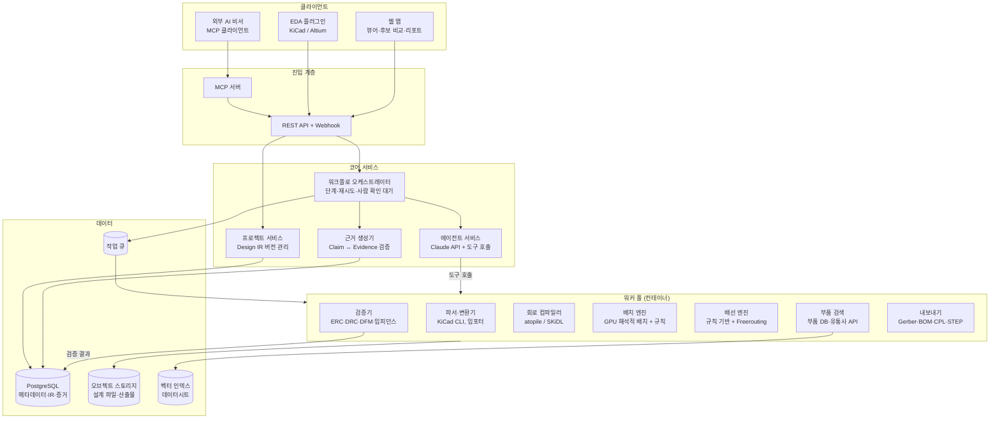
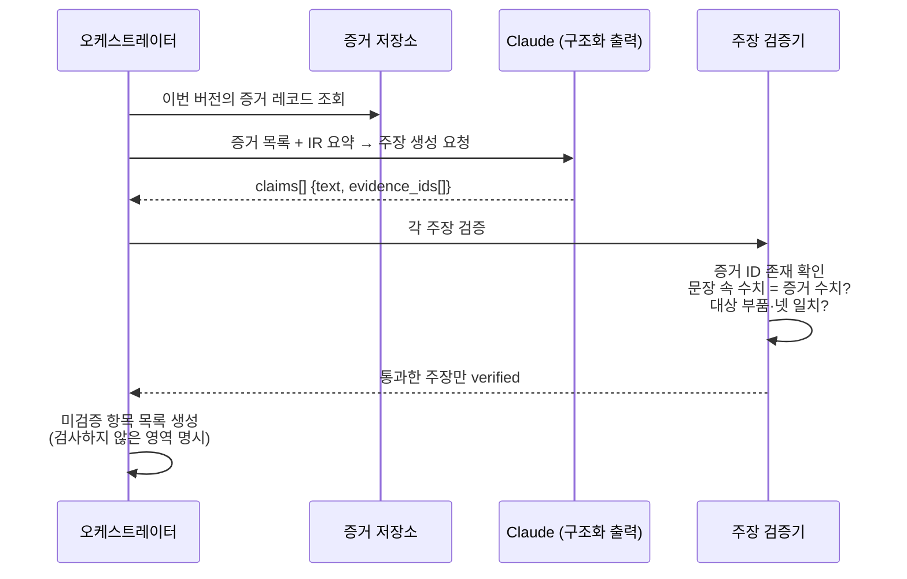
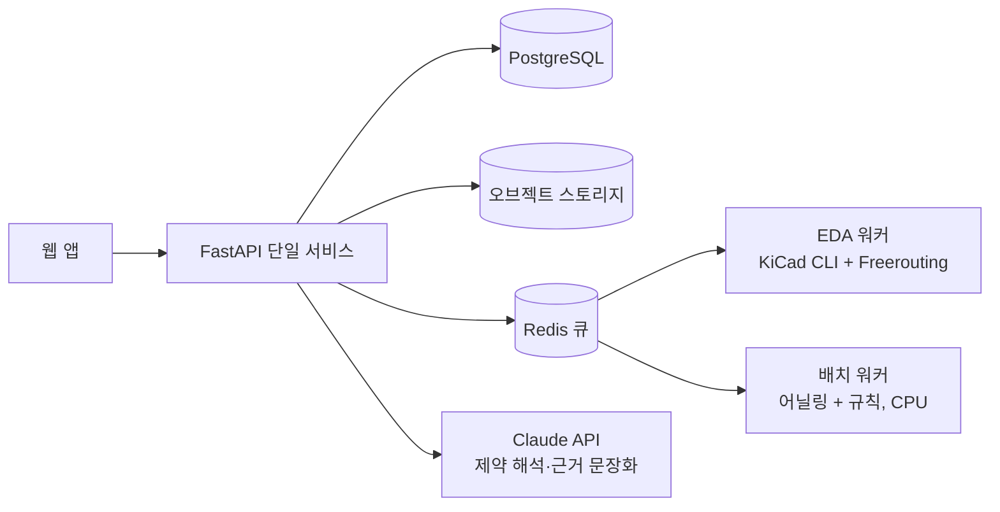

# NOAH Factory 기술 아키텍처 초안 (v0.1)

| 항목 | 내용 |
|---|---|
| 문서 상태 | 초안 (검토용) |
| 작성일 | 2026-11-16 |
| 함께 볼 문서 | [`docs/product-plan.md`](./product-plan.md) — 제품 기획서 초안 |
| 근거 자료 | `reports/모디팩토리 AI PCB 설계 조사.md`, `research_notes/모디팩토리 AI PCB 설계 조사/` |

> 기술 스택과 성능 수치는 **후보와 가설**입니다. 오픈소스 도구의 버전별 기능(특히 KiCad의 ODB++·IPC-2581 내보내기, IPC API)과 라이선스는 Phase 0에서 직접 확인해야 합니다.
>
> **변경 이력** — v0.1 (2026-11-16) 초안 / v0.2 (2026-11-16) 보충 조사(논문 원문·라이선스) 반영, §15 Phase 0 구현 현황 추가

---

## 1. 설계 원칙

| # | 원칙 | 이유 (근거) |
|---|---|---|
| 1 | **LLM은 의도 해석·코드 작성·설명을 맡고, 좌표와 배선은 결정론적 엔진이 만든다** | LLM이 KiCad 파일을 직접 쓰면 3.0%만 유효했지만, 코드를 쓰고 검사기로 반복 검증하면 82%가 유효했다 (SchGen). 2026 벤치마크에서 LLM 에이전트의 실전 레이아웃 성공률은 4.6~32%에 그친다 |
| 2 | **모든 산출물은 검증 게이트를 통과해야 다음 단계로 간다** | DRC 통과가 동작을 보장하지 않으므로, 가능한 검증을 최대한 앞단에서 반복한다 |
| 3 | **설계 근거는 증거 저장소의 레코드를 인용할 때만 생성한다** | PCB 설명 가능성 연구가 비어 있고, 근거 없는 설명은 환각 위험이 크다 |
| 4 | **단일 내부 표현(Design IR)으로 도구에 독립적인 구조** | KiCad·Altium·코드 기반 회로 등 입출력 형식이 다양하다 |
| 5 | **Anytime 실행**: 빠른 초안을 먼저, 개선은 백그라운드에서 | 90분 대기(MODI Factory)보다 짧은 반복 주기가 핵심 경험이다 |
| 6 | **재현성**: 엔진 버전, 규칙 세트, 시드, 모델 ID를 결과에 기록 | 품질 회귀 추적과 고객 신뢰 |

---

## 2. 전체 구성도



---

## 3. 핵심 데이터 모델

### 3.1 Design IR (단일 내부 표현)

모든 입력은 Design IR로 변환되고, 모든 출력은 Design IR에서 생성됩니다. 버전마다 불변(immutable) 스냅샷으로 저장합니다.

```yaml
DesignIR:
  meta: { project_id, version, parent_version, created_by: user|engine|agent, engine_versions, seed }
  requirements:            # 자연어 요구사항을 구조화한 결과
    functions: [...]       # 예: "1셀 리튬 배터리 충전"
    interfaces: [...]      # 예: USB-C, I2C x2
    constraints: [...]     # 예: 보드 50x40mm, 2층, 예산
  components:
    - ref: U1
      mpn: "<제조사 품번>"
      footprint: "<라이브러리:풋프린트>"
      pins: [{ number, name, type, voltage_domain }]
      source: { selected_by: user|agent, evidence_ids: [...] }
  nets:
    - name: VBUS
      class: power | signal | diff_pair | high_speed | analog
      pins: [U1.1, J1.A4]
      constraints: { width_min, impedance, length_match_group }
  board:
    outline: <폴리곤>
    stackup: { layers, thickness, dielectric }
    keepouts: [...]
    fab_profile: "<제조사 규칙 세트 ID>"
  placement:
    U1: { x, y, rotation, side, locked: true|false, lock_reason }
  routing:
    tracks: [...]
    vias: [...]
    zones: [...]
```

### 3.2 제약 조건 모델

| 필드 | 설명 |
|---|---|
| `kind` | hard(반드시 준수) / soft(최적화 목표) |
| `origin` | user(사용자 지정) / datasheet(데이터시트 권장) / fab(제조사 규칙) / agent(AI 제안) |
| `target` | 부품·넷·영역 |
| `expression` | 예: `distance(C3, U1.VDD) <= 2mm`, `edge(J1) == left` |
| `evidence_ids` | 이 제약의 출처가 되는 증거 (데이터시트 조항 등) |

사용자가 자연어로 말한 제약("USB 커넥터는 왼쪽 가장자리")은 에이전트가 이 구조로 변환하고, **사용자 확인 후** hard 제약이 됩니다.

### 3.3 증거(Evidence)와 주장(Claim) 모델 — 설계 근거의 토대

```yaml
Evidence:
  id: ev_0142
  type: drc_result | erc_result | dfm_result | metric | calc | sim_result | datasheet_excerpt | design_rule
  subject: { refs: [C3, U1], nets: [VDD_3V3] }
  payload: { ... }              # 예: { metric: "decap_distance_mm", value: 1.4, limit: 2.0 }
  produced_by: { tool: "kicad-cli drc", version: "9.x", rule_set: "fab_jlc_2layer_v3" }
  created_at: ...

Claim:
  id: cl_0057
  text: "C3는 U1의 3.3V 전원 핀에서 1.4mm 거리에 배치되어 데이터시트 권장(2mm 이내)을 만족합니다."
  evidence_ids: [ev_0142, ev_0098]
  status: verified | unverified | contradicted
  audience: beginner | expert
```

- 리포트에는 `verified` 주장만 근거로 표시하고, 검증하지 못한 항목은 별도 "검증 안 됨" 목록으로 보여 줍니다.
- 웹 뷰어에서 주장을 클릭하면 `subject`의 부품·넷을 하이라이트합니다.

---

## 4. 파이프라인 상세

| 단계 | 입력 → 출력 | 실행 주체 | LLM 역할 | 검증 게이트 |
|---|---|---|---|---|
| S0 요구사항 정리 | 자연어·블록도 이미지 → 구조화된 요구사항 | 에이전트 | 해석, 확인 질문 생성 | 사용자 확인 |
| S1 부품 선정 | 요구사항 → BOM 후보 | 부품 검색 워커 + 에이전트 | 후보 비교, 데이터시트 인용 근거 | 재고·전압·패키지 규칙 검사 |
| S2 회로도 생성 | BOM + 요구사항 → 회로 코드 → 넷리스트 | 회로 컴파일러 + 에이전트 | 회로 코드 작성·수정 | 컴파일 성공, ERC, 데이터시트 규칙 검사 (최대 N회 반복) |
| S3 보드 설정 | 외곽·층수·제조사 → 보드 규칙 | 템플릿 + 사용자 | 자연어 제약 → 구조화 | 규칙 세트 일관성 검사 |
| S4 배치 | 넷리스트 + 보드 → 배치 후보 3안 | 배치 엔진 | 없음 (제약 해석만) | 겹침 0, hard 제약 100% 준수, 배선 가능성 추정치 |
| S5 배선 | 배치 → 배선 | 배선 엔진 | 없음 | 미배선 수, 실패 시 S4로 피드백 |
| S6 검증 | 배선 완료 보드 → 증거 레코드 | 검증기 | 없음 | DRC·DFM 위반 0 (또는 사유와 함께 사용자 승인) |
| S7 근거 생성 | 증거 + IR → 주장 목록 → 리포트 | 근거 생성기 + 에이전트 | 증거를 문장으로 설명 | 모든 주장에 유효한 증거 인용, 수치 일치 |
| S8 내보내기 | IR → 제조·EDA 파일 | 내보내기 워커 | 없음 | 출력 파일 재파싱 검사 |

> 기존 파일에서 시작하는 흐름은 S0–S2를 건너뛰고 파서(S-1)에서 IR을 만든 뒤 S3부터 진행합니다.

### 4.1 S4 배치 엔진


- **전역 배치:** Cypress(NVlabs, ISPD 2025, Apache-2.0)의 GPU 해석적 배치 방식을 출발점으로 검토합니다. 논문은 기존 PCB 배치기 대비 최대 492.3배 빠른 실행과 1~5.9배 나은 배선 가능성을 보고합니다. 다만 연구 코드이므로 실데이터 적용성은 Phase 0에서 확인합니다.
- **MVP 대안:** GPU 없이 시뮬레이티드 어닐링 + 규칙 기반 보정으로 시작하고, 벤치마크로 비교한 뒤 교체합니다.
- **강화학습:** RL_PCB(DATE 2024, MIT) 방식은 처음 보는 회로에서 어닐링 대비 배선 후 길이 17~21% 단축을 보고했습니다. 사전 학습한 정책을 개선 단계에 쓰는 방안을 Phase 2 이후 검토합니다. 요청 시점에 학습하는 방식은 시간 목표에 맞지 않습니다.
- **LLM 배치(참고):** MODI Factory는 LLM이 주요 부품(MCU·USB·버튼)을, 점수 루프가 수동소자를 배치하는 혼합 방식을 씁니다. 연세대(대한전자공학회 2024)도 같은 구조(LLM 핵심 부품 + RL 수동소자)를 발표했습니다. NOAH는 Phase 1에서 LLM을 "배치 제약 제안자"로만 쓰고(예: "USB 커넥터는 왼쪽 가장자리"), 좌표는 엔진이 정하는 원칙(§1-1)을 유지합니다.
- **부품 고정:** 사용자 고정(locked)은 hard 제약으로 모든 단계에서 유지합니다.

### 4.2 S5 배선 엔진

1. **중요 넷 우선:** 전원·GND·차동쌍·고속 넷은 규칙 기반 배선(폭·간격·임피던스 규칙)과 템플릿으로 먼저 처리합니다.
2. **나머지 넷:** Freerouting(GPL-3.0)을 별도 프로세스로 헤드리스 실행합니다. Specctra DSN으로 내보내고 SES로 결과를 받아 IR에 반영합니다.
3. **그라운드 영역:** 존(zone) 채우기와 스티칭 비아를 규칙으로 처리합니다.
4. **실패 처리:** 미배선 넷이 남으면 혼잡 영역 정보를 S4로 돌려보내 국부 재배치 후 재시도합니다 (최대 횟수 제한).
5. **학습 기반 배선기:** PCBWorld(2026)의 RL 정책은 작은 보드에서만 Freerouting을 앞섰고(0.86 vs 0.80) 큰 보드에서는 뒤졌습니다. CADET(67.2%)는 Freerouting(65.6%)과 비슷한 수준이고, LLM 배선 에이전트 PCBRouteAgent도 큰 보드에서 40%에 그칩니다. 또한 PCBWorld·CADET 학습 모델은 비상업 라이선스라 그대로 쓸 수 없습니다. 자체 학습 모델이 공개 벤치마크에서 우위를 보일 때만 도입합니다.

### 4.3 S6 검증기

| 검사 | 도구 (후보) | 단계 |
|---|---|---|
| ERC | KiCad CLI | P0 |
| DRC | KiCad CLI (`kicad-cli pcb drc`, KiCad 8 이상 지원으로 알려짐 — 확인 필요) | P0 |
| DFM | 제조사별 규칙 세트 (최소 선폭·간격, 애뉴러 링, 드릴, 실크) | P0 |
| 데이터시트 규칙 | 디커플링 거리·값, 풀업, 핀 전압 도메인 — 데이터시트에서 추출한 규칙 | P1 |
| 임피던스 계산 | 스택업 기반 마이크로스트립·스트립라인 계산 | P1 |
| SI·PI·발열 해석 | 중요 넷 한정 외부 해석기 연동 | P2 |

검사 결과는 모두 Evidence 레코드로 저장되며, 이것이 설계 근거의 유일한 재료입니다.

### 4.4 S7 근거 생성기



- LLM은 증거 ID 목록 밖의 사실을 말할 수 없도록 구조화 출력 스키마로 제한합니다.
- 수치·부품명 불일치가 있는 주장은 버리고 재생성하지 않습니다(환각 방지 우선).
- 초보자 모드: 같은 주장을 쉬운 설명과 용어 풀이로 다시 씁니다. 근거 ID는 동일합니다.
- "검증 안 됨" 목록은 규칙으로 생성합니다. 예: "이 보드는 SI 해석을 수행하지 않았습니다."

### 4.5 S8 내보내기

| 출력 | 방식 (후보) | 단계 |
|---|---|---|
| KiCad 프로젝트 | IR → .kicad_sch / .kicad_pcb | P0 |
| Gerber·드릴·BOM·CPL | KiCad CLI | P0 |
| PDF 설계 리포트 | 근거 리포트 렌더링 | P0 |
| STEP 3D | KiCad CLI | P1 |
| IPC-2581·ODB++ | KiCad 최신 버전 지원 여부 확인 후 | P1 |
| Altium 되돌려 보내기 | 플러그인 또는 변환 경로 검토 | P1 |

---

## 5. 에이전트 설계 (Claude API)

### 5.1 구조: 코드가 흐름을 쥐고, 에이전트는 단계 안에서

전체 흐름(S0–S8)은 **오케스트레이터 코드(상태 기계)**가 통제합니다. 에이전트는 열린 추론이 필요한 단계(요구사항 정리, 부품 선정, 회로 코드 작성·수정, 근거 문장화) 안에서만 도구를 호출합니다. 이렇게 하면 비용·지연·실패 범위를 단계별로 통제할 수 있습니다.

### 5.2 모델과 호출 설정

| 항목 | 설정 |
|---|---|
| 모델 | `claude-opus-5-5` (전 단계 기본값) |
| 사고(thinking) | 적응형 (`thinking: {type: "adaptive"}`) — Opus 5.5는 사고를 끌 수 없음 |
| effort | 단계별 명시 설정. 회로 코드 작성·수정 루프는 `high`, 요구사항 구조화·근거 문장화는 `medium`에서 시작해 평가로 조정 (Opus 5.5 기본값은 `medium`) |
| 도구 호출 | 결정론적 도구를 `strict: true` 스키마로 정의. Opus 5.5는 `tool_choice`의 `any`/`tool` 강제를 지원하지 않으므로 `auto` + 프롬프트 지시로 유도 |
| 구조화 출력 | 요구사항 스펙, 주장 목록은 `output_config.format`(JSON 스키마)으로 받음 |
| 데이터시트 인용 | 데이터시트 PDF를 document 블록 + citations로 넣어 부품 선정 근거에 원문 위치를 붙임. citations는 `output_config.format`과 함께 쓸 수 없으므로 "인용 포함 분석 → 구조화 추출" 2단계로 분리 |
| 프롬프트 캐싱 | 시스템 프롬프트·도구 정의·설계 규칙 문서를 고정 접두부로 두고 캐시 |
| 긴 출력 | 스트리밍 사용 |
| 거절 처리 | `stop_reason: "refusal"` 확인 후 처리, 서버 측 fallback 설정 검토 |
| 오프라인 평가 | 벤치마크 대량 실행은 Message Batches API 사용 |
| 비용 최적화 | 모델 교체보다 effort 조정·캐싱을 먼저 측정 후 결정 |

### 5.3 에이전트 도구 목록 (안)

| 도구 | 기능 | 부작용 |
|---|---|---|
| `get_design_ir` | 현재 IR 조회 (요약/상세) | 없음 |
| `search_parts` | 사양·패키지·재고·가격으로 부품 검색 | 없음 |
| `get_datasheet` | 데이터시트 원문·추출 규칙 조회 | 없음 |
| `write_circuit_code` | 회로 코드(atopile/SKiDL) 저장 | IR 새 버전 |
| `compile_circuit` | 회로 코드 → 넷리스트, 오류 반환 | 없음 |
| `run_erc` / `run_drc` / `run_dfm` | 검사 실행 → Evidence 생성 | 증거 저장 |
| `propose_constraint` | 자연어 → 구조화 제약 (사용자 확인 대기) | 확인 대기 상태 |
| `run_placement` / `run_routing` | 엔진 작업 요청 (비동기) | IR 새 버전 |
| `calc_impedance` | 스택업 기반 임피던스 계산 | 증거 저장 |
| `ask_user` | 확인 질문 등록 → 사람 응답 대기 | 워크플로 일시정지 |

**가드레일:** 에이전트는 좌표나 배선 형상을 직접 쓰는 도구를 갖지 않습니다. 모든 기하 변경은 엔진을 거치고 검증기를 통과해야 합니다.

---

## 6. 외부 인터페이스

| 인터페이스 | 내용 | 단계 |
|---|---|---|
| REST API | 프로젝트 생성, 파일 업로드, 작업 실행·상태 조회, 결과 다운로드 | P0(내부) / P1(공개) |
| Webhook | 작업 완료·실패 알림 | P1 |
| MCP 서버 | `create_project`, `upload_design`, `run_layout`, `get_report`, `export` 도구 제공 → 사용자의 AI 비서가 직접 조작 | P1 |
| KiCad 플러그인 | 현재 보드를 업로드하고 결과를 되받기 | P1 |
| Altium 플러그인 | 위와 동일 (MODI Factory 대응) | P1–P2 |
| 부품 데이터 | 유통사·부품 DB API (약관·비용 검토 필요) | P1 |
| 제조사 | 견적·주문 연결 (API 제공 여부 업체별 확인) | P1 |

---

## 7. 기술 스택 (후보)

| 계층 | 후보 | 선택 이유 |
|---|---|---|
| 프론트엔드 | Next.js + TypeScript | 웹 앱·SSR·생태계 |
| PCB·회로도 뷰어 | KiCanvas(오픈소스 KiCad 웹 뷰어, 라이선스 확인 필요) 또는 자체 WebGL 렌더러 | KiCad 파일 직접 표시 |
| API 서버 | Python FastAPI | EDA 도구 생태계(KiCad Python, SKiDL, atopile)가 Python 중심 |
| 워크플로 | MVP: Celery + Redis / 확장: Temporal | 장시간 작업, 재시도, 사람 확인 대기 |
| EDA 워커 | KiCad 헤드리스(kicad-cli), Freerouting(Java) 컨테이너 | 검증된 오픈소스 엔진 |
| 배치 워커 | PyTorch + CUDA (GPU 노드) | GPU 해석적 배치 |
| 데이터베이스 | PostgreSQL (IR 버전은 JSONB), pgvector | 단일 DB로 메타데이터·증거·검색 |
| 파일 저장 | S3 호환 오브젝트 스토리지 | 설계 파일·산출물 |
| LLM | Claude API (`claude-opus-5-5`) | 도구 호출, 구조화 출력, 인용 |
| 관측성 | OpenTelemetry, 작업별 추적·비용 계측 | 단계별 지연·비용 분석 |
| 인프라 | Kubernetes (GPU 노드 오토스케일), 엔터프라이즈용 단일 테넌트 배포 차트 | 확장성, 전용 설치 |

---

## 8. 성능 예산 (목표: 배선 포함 초안 20분 이내, 가설)

부품 150개 이하, 2~4층 보드 기준. 실제 수치는 Phase 0에서 측정해 갱신합니다.

| 단계 | 목표 시간 | 비고 |
|---|---|---|
| 파싱·IR 변환 | 30초 | |
| 전역 배치 (후보 3안 병렬) | 1~3분 | GPU 워커 3개 병렬 |
| 규칙 보정·합법화 | 30초 | |
| 배선 | 5~10분 | 보드 복잡도에 비례, 후보별 병렬 |
| ERC·DRC·DFM | 1분 | |
| 근거 생성·검증 | 1~2분 | 스트리밍으로 먼저 보여 줌 |
| 내보내기 | 30초 | |
| **첫 배치 후보 노출** | **5분 이내** | 배선 전 후보를 먼저 보여 줌 |

---

## 9. 평가 체계

### 9.1 데이터셋

| 데이터셋 | 용도 |
|---|---|
| 공개 KiCad 프로젝트 (라이선스 필터링) | 실사용 분포 회귀 테스트 |
| PCBWorld (LG AI연구원, 679개 실제 보드) | 배선 품질 비교 (환경 코드는 허용적 라이선스, KiCad 기반 엔진은 GPLv3, 학습 모델은 비상업) |
| KiCad 공식 데모 프로젝트 | Phase 0 벤치마크 (현재 사용 중, §15) |
| Cypress 벤치마크 (41~476부품 소규모, 5,118~6,628부품 대규모) | 배치 품질·속도 비교 |
| RL_PCB 테스트 회로 | 배치 비교 |
| PCB-Bench 등 2026 LLM 벤치마크 | 에이전트 단계(요구사항·회로) 평가 |

### 9.2 지표

- **배치·배선:** 배선 완료율, DRC 위반 수, 총 배선 길이, 비아 수, 처리 시간, 데이터시트 규칙 준수율(예: 디커플링 거리)
- **근거:** 주장 중 유효 증거 인용 비율, 수치 불일치율, 사람 평가에서 "틀린 설명" 비율
- **에이전트:** 회로 컴파일 성공률, ERC 통과까지 반복 횟수, 사용자 확인 질문의 적절성
- **사용자:** 사용자 수정량(부품 이동 비율), 실제 동작률(설문)

### 9.3 운영

- 엔진·프롬프트 변경마다 회귀 서브셋을 CI에서 실행하고, 전체 세트는 야간 실행합니다.
- PCB 전문가의 블라인드 리뷰 루브릭을 분기마다 수행합니다.
- 공개 벤치마크 결과를 주기적으로 외부에 공개합니다.

---

## 10. 보안·데이터 거버넌스

- 전송(TLS)·저장 암호화, 프로젝트별 접근 제어, 고객별 데이터 격리
- **기본값: 고객 설계를 학습에 사용하지 않음.** 학습 활용은 명시적 동의(옵트인) 프로그램으로만 운영
- 보존 기간 설정, 삭제 요청 시 파기, 감사 로그
- LLM 공급자 측 데이터 보존 정책을 확인하고 계약 조건을 정리 (엔터프라이즈 요구사항 대응)
- 엔터프라이즈: 전용 클라우드 배포, SSO, 고객 관리 키(검토)

---

## 11. 오픈소스 라이선스 검토 (법률 검토 전 초안)

| 구성요소 | 라이선스 (조사 기준) | 사용 방식 | 주의점 |
|---|---|---|---|
| KiCad | GPL-3.0 등 | 별도 프로세스(CLI)로 실행 | 사내 설치판에 동봉해 배포하면 GPL 의무 발생 |
| Freerouting | GPL-3.0 | 별도 프로세스로 실행 | 위와 동일 |
| atopile | MIT | 라이브러리 | 고지 의무 |
| SKiDL | MIT | 라이브러리 | 고지 의무 |
| Cypress (NVlabs) | Apache-2.0 | 참조·포크 검토 | 특허 조항·고지 의무 |
| RL_PCB | MIT | 참조 | 고지 의무 |
| KiCAD-MCP-Server | MIT | 설계 참조 | — |
| PCBWorld·CADET 학습 모델 | 비상업 | 사용 불가 (평가 참고만) | 자체 학습 필요 |
| PCBSchemaGen v2 코드 | 비상업 | 사용 불가 | — |
| OmniLayout 데이터셋 | 라이선스 검토로 배포 중단 | 사용 불가 | — |

> SaaS 내부 실행과 고객 환경 배포는 의무가 다릅니다. 배포 형태가 정해지면 법률 검토가 필요합니다.

---

## 12. MVP 최소 구성 (Phase 1)



- 요구사항→회로도(S0–S2)는 Phase 2로 미루고, MVP는 **KiCad 파일 업로드 → 배치·배선 → 검증 → 근거 리포트 → 내보내기**에 집중합니다.
- 배치 엔진은 CPU 기반으로 시작하고, 벤치마크 비교 후 GPU 엔진으로 교체합니다.
- Claude는 MVP에서 제약 해석과 근거 문장화에만 사용합니다.

---

## 13. 기술 검증(스파이크) 목록

| # | 검증 항목 | 성공 기준 |
|---|---|---|
| 1 | KiCad CLI로 DRC·Gerber·BOM·CPL을 헤드리스 자동화 (KiCad 9/10) | 공개 프로젝트 30개에서 무인 완주 |
| 2 | Freerouting 헤드리스 성능 | 부품 수별 처리 시간·실패 패턴 측정 |
| 3 | Cypress를 실제 KiCad 보드에 적용 | KiCad ↔ Cypress 입출력 변환, 품질·시간 비교 |
| 4 | 배치 후보 3안의 다양성과 품질 | 후보 간 차이, 배선 완료율 |
| 5 | 근거 생성의 정확도 | 주장 인용률 100%, 사람 평가 오류율 측정 |
| 6 | Altium 파일 가져오기 품질 | KiCad 임포터 경유 시 손실 항목 목록 |
| 7 | 부품 데이터 API 약관·비용 | 상용 사용 가능 공급처 확보 |
| 8 | GPU 비용 대비 시간 목표 | 보드당 원가 추정 |

---

## 14. 열린 기술 질문

1. 회로 코드 언어로 atopile과 SKiDL 중 무엇을 기본으로 할 것인가? (LLM 생성 성공률로 비교)
2. 배치 엔진을 자체 개발할 범위는? (Cypress 포크 vs 자체 구현)
3. 중요 넷(차동쌍·고속) 배선을 자체 라우터로 할지, 상용 엔진 라이선스를 검토할지
4. 데이터시트에서 설계 규칙을 자동 추출하는 정확도를 어떻게 보장할지 (사람 검수 비율)
5. 사내 설치판에서 LLM 기능을 어떻게 제공할지 (클라우드 제공자 경유 vs 기능 축소)

---

## 15. Phase 0 구현 현황 (2026-11-16)

### 15.1 구현된 범위

§12의 MVP 최소 구성 중 **엔진 파이프라인**을 Python 패키지 `noah_factory`로 구현했습니다. 웹 앱·API·큐는 아직 없고 CLI로 실행합니다.

| 모듈 | 아키텍처 단계 | 내용 |
|---|---|---|
| `ir.py`, `kicad.py` | S-1 파서, Design IR | pcbnew(KiCad 10.0.8) → IR, 배치 반영, 배선 제거, 보드 외곽 래스터, 구리 장애물 추출 |
| `placement.py` | S4 배치 | 시뮬레이티드 어닐링(이동·연결 중심 당기기·교환·회전) + 규칙 항(디커플링 거리, 외부 커넥터 가장자리, 고정, 구리 장애물) → 0.05 mm 격자 정렬 → 합법화. 시드별 병렬(spawn 워커) |
| `routing.py` | S5 배선 | Freerouting 헤드리스 실행, `.kicad_pro`·`.kicad_dru` 규칙 전달 |
| `verify.py` | S6 검증 | `kicad-cli pcb drc` (존 재충전, 회로도 일치성), 위반을 전기·제조·배치·실크·환경·일치성으로 분류 |
| `evidence.py`, `rationale.py` | S7 근거 | 증거 저장소, 주장 검증기(숫자·식별자 대조), 규칙 템플릿 문장, "검증하지 않은 항목" 목록, `report.md` |
| `export.py` | S8 내보내기 | Gerber·드릴·부품 좌표 CSV, `fabrication.zip` |
| `pipeline.py`, `__main__.py` | 오케스트레이터 | 단계별 시간 기록, `run.json` |
| `bench/run_bench.py` | §9 평가 | KiCad 데모 보드 재배치·재배선 후 사람이 만든 원본과 같은 도구로 비교 |

### 15.2 구현하며 확인한 사실 (설계에 반영됨)

| # | 발견 | 대응 |
|---|---|---|
| 1 | Freerouting 최신 소스는 Java 25가 필요하고, GitHub 릴리스 대신 소스 빌드가 필요했다 | JDK 25 경로를 `NOAH_JAVA`로 지정 |
| 2 | 격자에서 벗어난 좌표(예: 130603.074 µm)가 있으면 Freerouting이 `NegativeArraySizeException`으로 배선을 전부 포기한다 | 합법화 전에 0.05 mm 격자로 정렬 |
| 3 | KiCad의 Specctra 내보내기는 보드 위 구리 텍스트·그래픽과 사용자 규칙(`.kicad_dru`), 최소 선폭을 빠뜨린다 | 배선용 사본에 구리 텍스트 킵아웃을 추가하고 `.kicad_pro`·`.kicad_dru`를 Freerouting에 전달 |
| 4 | 구리 영역(GND 존)이 있으면 Freerouting은 해당 넷을 "평면으로 연결됨"으로 보고 배선하지 않는데, 배치가 바뀌면 재충전된 존이 끊겨 미연결 패드가 생길 수 있다. 반대로 구리 영역을 처음부터 지우면 GND 영역에 의존하는 2층 보드는 배선이 훨씬 어려워진다(multichannel_mixer: 600초 후 미배선 150) | **2단계 배선**: 1단계는 구리 영역을 유지한 채 배선 → 영역 재충전 후 미연결 확인 → 남은 연결이 있을 때만 2단계에서 영역을 빼고 기존 트랙을 유지한 채 나머지를 트랙으로 배선 |
| 5 | 배치기가 보드 위 구리 텍스트를 몰라 패드를 그 위에 올렸다 | 구리 텍스트·그래픽·풋프린트 킵아웃을 배치 장애물로 반영 |
| 6 | pcbnew를 불러온 프로세스를 fork하면 부모의 SWIG 상태가 깨진다 | 배치 워커를 spawn 방식으로 실행 (배치 모듈은 pcbnew를 import하지 않음) |
| 7 | `BOARD.Remove()`는 파이썬 래퍼에 소유권을 넘겨 메모리 누수 경고를 낸다 | `BOARD.Delete()` 사용 |
| 9 | 시간 제한에 걸린 Freerouting 프로세스를 강제 종료하면 결과 파일(SES)이 저장되지 않아 그때까지의 배선이 모두 사라진다(interf_u: 2단계에서 미배선 4개까지 줄인 결과 유실) | Freerouting 자체 작업 시간 제한(`--router.job_timeout`)을 써서 정상 종료시키고 최선 결과를 저장. 프로세스 강제 종료는 안전장치로만 유지 |
| 10 | 넷클래스 값(예: 0.2 mm)이 보드 최소 규칙(0.3 mm)보다 느슨하면 Specctra 내보내기가 넷클래스 값을 써서, 배선 결과가 KiCad DRC에서 대량으로 걸린다(multichannel_mixer: 선폭 위반 199건, 제조 위반 437건) | 배선용 사본의 넷클래스 선폭·간격·비아 크기를 보드 최소 규칙 이상으로 올림(1 µm 단위 올림) |
| 11 | Freerouting은 `.kicad_pro`의 최소 선폭(198.12 µm)을 넥다운 폭으로 쓰면서 정수 µm로 잘라(198 µm) KiCad 최소값보다 0.1 µm 좁은 트랙을 만든다(kit_dev_coldfire: 원본 배치에서도 199건) | 보드 최소 선폭을 올림한 값을 `--router.neck_width_um`으로 직접 전달 |
| 12 | KiCad는 티어드롭을 고정 좌표의 구리 영역(zone)으로 저장한다. 부품을 옮기면 티어드롭과 특정 부품 주변에 그린 국소 구리 영역이 옛 위치에 남는다(complex_hierarchy: 티어드롭 167개) | 재배치 시 티어드롭과 보드 면적 30% 미만의 국소 구리 영역을 제거하고 리포트에 근거로 기록. complex_hierarchy의 전기 DRC가 8건 → 0건 |
| 13 | 2단계 배선에서 모든 구리 영역을 지우면, Freerouting 팬아웃이 평면 넷(+3.3V·GND) 패드에 짧은 조각을 만든 뒤 끝이 끊긴 채 남긴다(kit_dev_coldfire: `track_dangling` 11건). 반대로 내층 평면을 남기면 배선기가 평면 넷을 "이미 연결됨"으로 보고 다시 배선하지 않는다(+3.3V 미연결 17 → 15건) | 2단계는 1단계 후에도 미연결인 넷의 구리 영역만 (모든 층에서) 제거하고 나머지 넷의 구리 영역은 유지. 배선 후 KiCad DRC가 지목한 끊긴 트랙·비아를 UUID로 찾아 제거(최대 3회) |
| 14 | 상대 경로 작업 폴더를 쓰면, 작업 디렉터리를 바꿔 실행되는 Freerouting이 DSN 파일을 찾지 못해 배선을 전혀 하지 않는다 | 실행 경로를 모두 절대 경로로 변환 |
| 15 | 일부 라이브러리 풋프린트는 패드가 자기 코트야드 밖으로 나와 있다(KiCad 데모 19개 부품, 예: kit_dev_coldfire J201). 코트야드만 보고 간격을 지키면 이웃 부품이 그 패드에 닿아 단락된다 | 부품 외곽 = 코트야드 ∪ 패드 영역 |
| 16 | Freerouting은 멀티스레드·시간 제한으로 동작해, 같은 배치·같은 코드에서도 미연결 수가 실행마다 평균 1.5개 달라진다 | 설정 비교는 반복 실행으로 판단. 재현성 확보 방안은 다음 과제 |
| 8 | 초밀집 보드(StickHub)는 배치기가 쓰는 축 정렬 사각형 기준 부품 면적이 앞면 96%, 뒷면 191%로, 겹침 없는 해가 존재하지 않는다. 뒷면의 45° 회전 부품은 사각형이 실제보다 거의 두 배 커진다. 원본은 45° 회전과 실제 코트야드 다각형으로 채운 설계다 | 밀집도를 증거로 기록하고 85% 초과 시 리포트에 경고. `--init current`를 기존 배치의 국소 개선 모드로 변경. 다각형 충돌 검사, 45° 부품의 0°/90° 정렬 후보 추가는 Phase 1 과제 |

### 15.3 벤치마크

결과와 방법은 [`bench/results/summary.md`](../bench/results/summary.md), 해석은 [`bench/results/analysis.md`](../bench/results/analysis.md)에 있습니다.

요약 (KiCad 데모 8개, 4코어, 각 1회):

| 지표 | 결과 |
|---|---|
| 무인 완주 | 8/8 |
| 미배선 0 | 4/8 |
| 전기 DRC 0 | 3/8 |
| 배치 시간 (4시드 병렬) | 5.6~70초 |
| 전체 시간 | 12초~14분 (배선 시간 제한 2단계 × 420초) |
| 근거 문장 | 105개 모두 검증 통과 |

사람 배치를 같은 파이프라인으로 배선한 대조 실험에서, 배치 병목 3개 보드(interf_u, complex_hierarchy, kit_dev_coldfire)와 배선기 병목 1개 보드(multichannel_mixer)가 구분되었습니다. 다음 엔진 과제는 §4.1의 "배선 가능성 평가"를 비용 함수 안으로 넣는 것(혼잡도 추정)입니다.

### 15.4 혼잡도 반영 배치 (2026-11-17)

**모델 (`noah_factory/congestion.py`, RUDY 방식)**
- 보드를 긴 변 기준 32칸 격자(칸 크기 1~5 mm)로 나눈다.
- 넷마다 예상 배선 길이(HPWL × 다핀 넷 보정)를 그 넷의 외곽 사각형이 덮는 칸에 고르게 나눠 더한다. 연결된 핀마다 자기 칸의 용량을 조금 쓴다(탈출 배선).
- 보드 전체 평면(구리 영역이 보드의 30% 이상)으로 연결되는 넷은 수요를 낮춰 계산한다.
- 칸별 용량 = 배선층 수 × 사용 가능 비율(0.5) ÷ 트랙 피치(선폭+간격) × 칸 면적. 내층 중 구리 영역이 60% 넘게 덮는 층은 평면으로 보고 배선층에서 뺀다.
- 지표: ACE5(가장 붐비는 5% 칸의 평균 사용률), 용량 초과 칸 비율, 초과 배선량(mm). 비용 항은 사용률 1을 넘는 만큼의 제곱합.
- 어닐링에서는 옮긴 부품과 관련된 넷·핀만 증분 갱신한다(전체 재계산과 일치하는지 테스트로 확인). 비용 계산이 이동당 비용을 두 배로 늘려, 배치 일정의 40% 지점부터 켠다.

**사전 검증: 지표가 배선 결과를 설명하는가** (`bench/congestion_check.py`)

| 보드 | 사람 배치 ACE5 | 기존 NOAH ACE5 | 용량 초과 칸 % (사람 / NOAH) | 배선 결과 (사람 배치 / NOAH) 미배선 |
|---|---|---|---|---|
| ecc83, sonde_xilinx, pic_programmer | 0.31~0.52 | 0.39~0.60 | 0 / 0 | 0 / 0 |
| interf_u | 1.06 | 1.08 | 2.2 / 3.1 | 0 / 5 |
| kit_dev_coldfire | 0.77 | 0.86 | 0.3 / 1.2 | 0 / 5 |
| stickhub | 1.10 | 1.33 | 3.8 / 10.5 | 3 / 43 |
| complex_hierarchy | 0.41 | 0.50 | 0 / 0 | 0 / 0 (전기 DRC는 티어드롭 문제, §15.2-12) |
| multichannel_mixer | 0.58 | 0.57 | 0 / 0 | 160 / 131 (배선기 병목) |

용량 초과 칸이 생긴 보드는 모두 NOAH 배치가 배선에 실패한 보드였다. 배선기 병목 보드(multichannel_mixer)는 혼잡도로 설명되지 않는다.

**A/B: 가중치 0 vs 10, 시드 세트 2개, 배치 병목 3개 보드** ([`bench/results/congestion_ab.md`](../bench/results/congestion_ab.md))

| 보드 | 미배선 (가중치 0 → 10) | 용량 초과 칸 % | HPWL |
|---|---|---|---|
| interf_u | 4, 7 → **0, 5** | 3.0 → 1.4 | 4,425 → 4,336 mm |
| kit_dev_coldfire | 13, 2 → **4, 4** | 0.5 → 0.2 | 6,849 → 7,898 mm (+15%) |
| complex_hierarchy | 0, 0 → 0, 0 | 0 → 0 | 1,112 → 1,217 mm (+9%) |

- 미배선 합계 26 → 13. 표본이 작아(보드당 2회) 통계적 확정은 아니지만 두 보드 모두 같은 방향이다.
- 대가는 배선 길이 추정치(HPWL) 증가다. 배선 가능성을 위해 부품을 펼치는 정상적인 교환이다.
- 같은 실험에서 늘어난 전기 DRC는 배치가 아니라 배선 단계 문제로 확인되어(§15.2-13) 함께 고쳤다.

**배선 수정 재검증** ([`bench/results/reroute_after_fixes.md`](../bench/results/reroute_after_fixes.md))

A/B의 12개 배치를 그대로 두고 수정된 배선(표적 2단계 + 끊긴 조각 정리)으로 다시 배선했다.

| 지표 (12건 합계) | 수정 전 | 수정 후 |
|---|---|---|
| 끊긴 조각 (`track_dangling`·`via_dangling`) | 14 | **0** |
| 전기 DRC | 48 | **31** (−35%) |
| 그중 `starved_thermal` | 33 | 30 |
| 미배선 | 39 | 50 (배선기 실행 편차 범위, 위 표 #16) |

남은 전기 DRC의 97%는 `starved_thermal`(열 차단 스포크 부족)이며 다음 배선 과제다.
