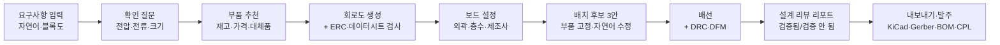

# NOAH Factory 제품 기획서 (초안 v0.1)

| 항목 | 내용 |
|---|---|
| 문서 상태 | 초안 (검토용) |
| 작성일 | 2026-11-16 |
| 제품명 | NOAH Factory (가칭) |
| 근거 자료 | `reports/모디팩토리 AI PCB 설계 조사.md`, `research_notes/모디팩토리 AI PCB 설계 조사/` |
| 함께 볼 문서 | [`docs/architecture.md`](./architecture.md) — 기술 아키텍처 초안 |

> 이 문서의 시장·경쟁사 정보는 2026-11 조사 결과입니다. v0.2에서 보충 조사(공식 FAQ·약관·DART·논문 원문·벤더 가격 페이지 직접 확인) 결과를 반영했습니다. 일정·성능 목표·가격은 모두 **가설**입니다.
>
> **변경 이력** — v0.1 (2026-11-16) 초안 / v0.2 (2026-11-16) 보충 조사 반영, 결정 기록(`docs/decisions.md`) 연결, Phase 0 진행 현황 추가

---

## 0. 한 줄 정의

**"만들고 싶은 기기를 말하면, 주문 가능한 PCB까지 — 모든 설계 결정에 검증된 근거를 붙여 주는 AI PCB 설계 서비스"**

---

## 1. 배경과 기회

### 1.1 시장 현황 요약 (2026-11 기준)

| 구분 | 주요 플레이어 | 하는 일 | 한계/공백 |
|---|---|---|---|
| 국내 직접 경쟁 | **MODI Factory** (럭스로보) | 회로도+레이아웃 파일(Altium·KiCad 8+·EasyEDA) 업로드 → 약 90분(배치 30분+배선 60분) 내 AI 배치·배선 후보 + 배치/배선 노트. LLM이 주요 부품을, 점수 루프가 수동소자를 배치하는 혼합 방식. KiCad·Altium·EasyEDA·Gerber·PDF 출력, Altium 플러그인. 2026-03-06 Early Access 공개, 2026년 말까지 무료 | 회로도 필수(레이아웃만 배치는 개발 중), 부품 300개·연결 1,200개·하루 배치/배선 각 5회 제한, SI·PI 미지원(열 해석 개발 중), 부품 선정·발주 연동 없음. **약관상 업로드 파일 R&D 활용 동의 간주, 생성 레이아웃 저작권은 럭스로보 귀속**(FAQ의 "학습 미사용"과 상충) |
| 해외 AI 레이아웃 | Quilter, DeepPCB | 레이아웃 후보 + 물리 기반 리뷰(Quilter, 미배선 핀 수 기준 프로젝트당 과금), 강화학습 오토라우터(DeepPCB, $30/1시간·$280/10시간·$800/30시간) | 전문가 대상. Quilter 무료 티어(10인 미만·매출 $50K 미만)는 업로드 파일을 학습에 사용하며 회로도 생성은 하지 않음. DeepPCB 종량제는 8층·연결 1,200개·부품 1,000개 제한 |
| 해외 AI 회로·에디터 | Flux, Circuit Mind, CELUS | 브라우저 에디터 + AI 코파일럿(Flux), AI 회로도 생성·검증(Circuit Mind) | 레이아웃 자동화와 분리, 한국어·국내 생태계 미지원 |
| 대형 EDA | Cadence, Siemens, Zuken | 기존 도구에 AI 보조 기능 추가 | 숙련 설계자 보조용, 고가 |
| 제조 연계 | JLC/EasyEDA | AI 코딩 에이전트 연동 공개 베타 예고(2026) | 저가 제조와 AI 설계 결합 시 위협 |
| 국내 인접 | 세카(SECA, LG전자 분사) | AI로 하드웨어 설계 문서 불일치 검사, AI 배치·배선 진출 예고 | 아직 레이아웃 자동화 미제공 |

### 1.2 학술 연구가 주는 시사점

- **LLM이 회로를 직접 쓰면 실패하고, 코드를 쓰게 한 뒤 검사기로 반복 검증하면 성공률이 크게 오른다.** (예: SchGen — KiCad 파일 직접 작성 3.0% vs 코드+검증 루프 82% 유효)
- **DRC를 통과해도 실제로 동작하지 않는 보드가 많다.** 2026년 벤치마크(EDA Bench 4.58%, PCBInnoBench 7.3–22%, PCB Gym 약 32%)에서 에이전트의 실전 성공률은 낮다.
- **학습 기반 배선기는 작은 보드에서만 규칙 기반을 앞선다.** PCBWorld(2026)의 RL 정책은 작은 보드에서 Freerouting을 앞섰지만(0.86 vs 0.80) 큰 보드에서는 뒤졌고, CADET의 배선 완료율(67.2%)은 Freerouting(65.6%)과 비슷하다. LLM 배선 에이전트 PCBRouteAgent(2026-11)도 작은 보드 94.9%, 큰 보드 40%로 규모에 따라 성능이 크게 떨어진다.
- **배치는 GPU 해석적 배치(Cypress, ISPD 2025)와 강화학습(RL_PCB, DATE 2024)이 가장 근거가 강하다.** 국내에서는 연세대(2024)가 LLM으로 핵심 부품, RL로 수동소자를 배치하는 방식을 발표했다(MODI Factory와 유사한 구조).
- **PCB 설계의 설명 가능성(설계 근거) 연구는 사실상 비어 있다.** → 차별화 여지가 크지만, 검증 결과와 연결되지 않은 설명은 환각 위험이 있다.
- **AI 레이아웃 도구의 독립 벤치마크는 없다.** 유일한 비교 자료는 DeepPCB의 자사 비교(배선 완료율 97.3% vs Quilter 87.7%)다. → 공개 벤치마크 결과를 직접 공개하는 것 자체가 신뢰 수단이 된다.
- **현업 엔지니어는 AI를 리뷰·BOM·라이브러리 작업에는 신뢰하지만 배치는 신뢰하지 않는다.** (Hacker News·EEVblog·KiCad 포럼 의견) → "검증과 근거"를 앞세우는 포지셔닝이 맞다.
- **공개 모델·데이터의 상업 이용 제약:** PCBWorld·CADET 학습 모델과 PCBSchemaGen v2 코드는 비상업 라이선스이고, OmniLayout 데이터셋은 라이선스 검토로 내려갔다. → 자체 엔진·자체 데이터가 필요하다.

### 1.3 기회

다음 네 가지를 **동시에** 제공하는 서비스는 국내외에서 확인되지 않았다.

1. 요구사항(자연어)에서 시작해 발주 가능한 파일까지 이어지는 **엔드투엔드** 흐름
2. 회로도를 그려 본 적 없는 사용자도 끝까지 갈 수 있는 **초보자 친화성**
3. 실제 검사·계산·데이터시트에 연결된 **검증 기반 설계 근거**
4. **한국어**와 국내 제조사·부품 유통망 연동

---

## 2. 문제 정의

| 사용자 | 지금 겪는 문제 | 근거 |
|---|---|---|
| 메이커·학생 | 회로도 단계부터 막힘. EDA 학습 곡선이 높고 부품 선정·제조 파일·발주 지식이 부족 | MODI Factory도 회로도 파일이 있어야 시작 가능 |
| 하드웨어 스타트업 | PCB 외주는 건당 수십만 원·수일 소요, 수정할 때마다 다시 기다림 | 크몽 PCB 설계 외주 약 10만~33만 원, 수일 |
| 현업 엔지니어 | 반복적인 배치·배선 작업에 시간 소모, AI 결과를 믿을 근거가 없음, 설계 IP 유출 우려 | 해외 AI 도구는 "전문가 검토 필요" 고지, 무료 티어 학습 사용 사례 |

**핵심 문제 문장:** "PCB를 만들고 싶은 사람은 많지만, 회로도→배치→배선→검증→발주의 각 단계마다 전문 지식이 필요하고, 기존 AI 도구는 그중 한 단계만 돕거나 왜 그렇게 설계했는지 믿을 근거를 주지 않는다."

---

## 3. 제품 원칙

1. **근거 없는 결정은 없다 (Evidence-first)** — 모든 설계 근거 문장은 검사 결과·계산값·데이터시트 조항·설계 규칙 중 하나를 인용해야 한다. 검증하지 않은 항목은 "검증 안 됨"으로 명시한다.
2. **AI는 초안, 결정은 사람 (Human-in-the-loop)** — 사용자는 언제든 고정·수정·되돌리기를 할 수 있고, AI는 그 제약을 지킨다.
3. **분 단위 첫 초안, 점진적 개선 (Anytime)** — 몇 분 안에 볼 수 있는 결과를 먼저 주고, 백그라운드에서 품질을 높인다.
4. **도구 종속 없음 (Open I/O)** — KiCad를 1급으로 지원하고, 결과를 사용자의 EDA 도구로 되돌려 보낼 수 있다.
5. **내 설계는 내 것 (Privacy by default)** — 업로드한 설계는 기본적으로 AI 학습에 쓰지 않는다.

---

## 4. 타깃 사용자

| 페르소나 | 설명 | 핵심 니즈 | 단계 |
|---|---|---|---|
| **P1. 하드웨어 스타트업 개발자** | 펌웨어·소프트웨어는 능숙하지만 PCB 경험은 적음. 시제품을 빠르게 반복 제작 | 빠른 초안, 믿을 수 있는 검증, 발주까지 원스톱 | **초기 핵심 타깃** (지불 의사 + 고통 큼) |
| **P2. 메이커·학생** | 아두이노/ESP32 수준 프로젝트를 자체 보드로 만들고 싶음 | 회로도 없이 시작, 쉬운 설명, 무료 | 초기 확산 타깃 |
| **P3. 중소기업 HW 엔지니어** | Altium/KiCad 사용, 반복 업무 축소 원함 | 기존 도구 연동, 품질·보안, IP 보호 | 2단계 타깃 |

**초기 집중(가설):** P1을 핵심으로, P2를 무료 사용자 기반으로 삼는다. P3는 Altium 연동과 보안 기능이 갖춰진 뒤 공략한다.

---

## 5. 핵심 사용자 여정

### 5.1 기본 흐름: 요구사항에서 시작

**예시 시나리오:** "ESP32-S3, USB-C 전원, 1셀 리튬 배터리 충전, I2C 센서 2개, 50×40mm 2층 보드"
1. AI가 블록 다이어그램을 그리고 "배터리 충전 전류는 몇 mA가 필요한가요?" 같은 확인 질문을 한다.
2. 충전 IC·LDO·커넥터 후보를 재고·가격과 함께 제시하고, 선택 이유를 데이터시트 인용과 함께 보여 준다.
3. 회로도를 생성하고 ERC·데이터시트 규칙(디커플링 커패시터 값, 풀업 저항 등)을 검사한다.
4. 배치 후보 3개를 몇 분 안에 보여 주고, 사용자가 USB 커넥터를 보드 왼쪽 가장자리에 고정한다.
5. 배선과 DRC·DFM 검사 후 "검증된 항목 / 검증 안 된 항목"이 구분된 리포트를 낸다.
6. KiCad 프로젝트·Gerber·BOM·CPL을 내려받거나 제조사 견적으로 이동한다.

### 5.2 대체 흐름: 기존 설계 파일에서 시작

기존 회로도·PCB 파일(KiCad, 이후 Altium)을 업로드하면 5.1의 **보드 설정(E)부터** 진행한다. MODI Factory가 다루는 범위를 그대로 포함한다.

---

## 6. 기능 요구사항

우선순위: **P0** = MVP(비공개 베타) / **P1** = 공개 베타 / **P2** = 정식 출시 이후

| ID | 기능 | 설명 | 우선순위 | 차별 포인트 |
|---|---|---|---|---|
| F1 | 프로젝트·파일 업로드 | KiCad 프로젝트(.kicad_sch/.kicad_pcb), 넷리스트 업로드 | P0 | — |
| F2 | 자동 배치 | 복수 후보(3안), 부품 고정(Lock), 보드 외곽·금지 영역 준수 | P0 | 분 단위 첫 후보 |
| F3 | 자동 배선 | 전원·GND 우선 규칙 + 오토라우터, 미배선 시 배치로 피드백 | P0 | — |
| F4 | 검증 | ERC·DRC·제조사별 DFM 규칙 검사 | P0 | 결과를 근거 데이터로 저장 |
| F5 | 검증 기반 설계 근거 리포트 | 모든 근거 문장에 검사 결과·계산·데이터시트·규칙 인용. "검증 안 됨" 항목 명시, 초보자/전문가 모드 | P0 | **핵심 차별점** |
| F6 | 내보내기 | KiCad 프로젝트, Gerber/드릴, BOM, CPL(부품 실장 좌표) | P0 | — |
| F7 | 웹 뷰어 | 회로도·PCB 2D 보기, 후보 비교, 근거 항목 클릭 시 해당 위치 하이라이트 | P0 | — |
| F8 | 요구사항 → 블록도 → 부품 선정 | 자연어 입력, 확인 질문, 재고·가격·대체품 제시 | P1 | **엔드투엔드** |
| F9 | 회로도 자동 생성 | 회로를 코드로 생성 → 컴파일 → ERC·데이터시트 검사 반복 | P1 | **회로도 없이 시작** |
| F10 | 대화형 수정 | "이 커넥터를 왼쪽으로", "USB 차동쌍 90Ω" 같은 자연어 제약 | P1 | — |
| F11 | 고급 배선 규칙 | 임피던스 제어, 차동쌍, 길이 매칭 | P1 | — |
| F12 | Altium 가져오기·되돌려 보내기 | Altium 사용자의 기존 작업 흐름 유지 | P1 | P3 공략 |
| F13 | API·MCP 서버 | 사용자의 AI 비서(Claude 등)가 서비스를 직접 조작 | P1 | 에이전트 친화 |
| F14 | 발주 연동 | 제조사 견적·주문 연결(국내 업체 포함) | P1 | 원스톱 |
| F15 | 물리 해석 연동 | 중요 넷의 SI·PI·발열 해석 결과를 근거로 반영 | P2 | 신뢰도 |
| F16 | 협업·버전 관리 | 팀 공유, 설계 버전 비교, 리뷰 코멘트 | P2 | — |
| F17 | 엔터프라이즈 | 전용 클라우드·사내 설치, SSO, 감사 로그 | P2 | IP 보호 |
| F18 | 학습 모드·레퍼런스 디자인 | 검증된 템플릿 라이브러리, 단계별 설명 | P2 | 초보자 |
| F19 | 전문가 리뷰 연결 | 유료로 PCB 전문가 검토 요청 | P2 | 품질 보완 |

---

## 7. 비기능 요구사항

| 영역 | 요구사항 (목표는 가설, Phase 0에서 검증) |
|---|---|
| 속도 | 첫 배치 후보 **5분 이내**, 배선 포함 초안 **20분 이내** (부품 150개 이하, 2~4층 기준). MODI Factory의 90분 대비 단축 |
| 품질 | 내부 벤치마크에서 미배선 0, DRC 위반 0으로 끝나는 비율을 지속 측정·공개 |
| 근거 정확도 | 근거 문장 중 유효한 증거를 인용하는 비율 100% (인용 없는 문장은 자동 제거) |
| 보안 | 전송·저장 암호화, 고객별 데이터 격리, 기본 학습 미사용, 삭제 요청 시 파기, 감사 로그 |
| 재현성 | 결과마다 엔진 버전·규칙 세트·랜덤 시드·AI 모델 ID 기록 |
| 안정성 | 작업 큐 기반 처리, 실패 시 재시도, 중간 결과 보존 |
| 언어 | 한국어·영어 UI 및 리포트 |

---

## 8. 경쟁 대비 포지셔닝

| 항목 | **NOAH Factory (목표)** | MODI Factory | Quilter | Flux |
|---|---|---|---|---|
| 시작점 | 자연어 요구사항 **또는** 기존 파일 | 회로도 + 레이아웃 파일 (Altium·KiCad 8+·EasyEDA) | Altium·Cadence·Siemens·KiCad 파일 | 브라우저 에디터에서 직접 설계 |
| 첫 결과 | 수 분 (목표, Phase 0 실측은 §14) | 약 90분 (배치 30분 + 배선 60분) | 보드 규모에 따라 수 시간 이상 (843부품 사례 AI 약 27시간) | 대화형 |
| 설계 근거 | 검사·계산·데이터시트 인용 필수, 미검증 항목 명시 | 배치·배선 노트 (배선 품질 지표 4종) | 후보별 물리 기반 설계 리뷰 | AI 코파일럿 대화 |
| 대상 | 초보자 ~ 현업 | 초보자 표방, 실제로는 회로도 작성 가능자 | 전문가 | 초보자 ~ 전문가 (가입자 100만+) |
| 사용 한도 | 미정 | 부품 300개, 하루 배치·배선 각 5회 | 프로젝트 단위 과금 | AI 크레딧 (크레딧 소모 불만 사례 있음) |
| 데이터 정책 | 기본 학습 미사용, 결과물 권리는 사용자 | 약관상 업로드 파일 R&D 활용, 결과물 저작권 럭스로보 귀속 (FAQ와 상충) | 무료 티어 파일 학습 사용, 엔터프라이즈 미사용 | 확인 안 됨 |
| 제조 연계 | 발주 연동 (P1) | Gerber·PDF 출력, JLCPCB 발주 안내 | Gerber·드릴 출력 | 확인 안 됨 |

> MODI Factory·Quilter·DeepPCB 정보는 공식 FAQ·약관·가격 페이지에서 직접 확인했습니다(2026-11). Flux 가격은 페이지가 스크립트로 채워져 확인하지 못했습니다.

**포지셔닝 문장:** "회로도를 그릴 줄 몰라도 시작할 수 있고, AI가 왜 그렇게 설계했는지 검증된 근거로 보여 주는 한국어 AI PCB 설계 서비스"

---

## 9. 성공 지표

**North Star:** 주당 "발주 가능 상태(DRC·DFM 통과)로 내보낸 보드 수"

| 지표 | 정의 | 용도 |
|---|---|---|
| 첫 초안까지 시간 | 업로드/요구사항 확정 → 첫 배치 후보 (p50/p90) | 속도 약속 검증 |
| 1차 클린 완료율 | 첫 초안이 미배선 0·DRC 위반 0인 비율 | 엔진 품질 |
| 사용자 수정량 | AI 결과에서 사용자가 옮긴 부품 비율·다시 그린 배선 길이 | 실사용 품질 |
| 근거 유용성 | 근거 항목별 👍/👎, "이 설명이 도움이 되었나요" | F5 품질 |
| 실제 동작률 | 제작 후 "보드가 정상 동작했다" 응답 비율 (bring-up 설문) | DRC 통과 ≠ 동작 문제 추적 |
| 무료 → 유료 전환율 | 유료 플랜 가입 / 활성 사용자 | 사업성 |
| 재방문율 | 30일 내 두 번째 프로젝트 생성 비율 | 유지율 |

**외부 공개 벤치마크:** PCBWorld(679개 실제 보드), Cypress 벤치마크, PCB-Bench 등 공개 데이터셋 성적을 정기적으로 공개해 신뢰를 확보한다.

---

## 10. 수익 모델 (가설)

| 플랜 | 대상 | 포함 내용 (안) |
|---|---|---|
| Free | P2 메이커·학생 | 월 소수 프로젝트, 부품 수 제한, 기본 근거 리포트, **학습 미사용** |
| Pro | P1 스타트업·개인 | 무제한 초안, 고급 배선 규칙, 우선 처리, 요구사항→회로도 |
| Team | 소규모 팀 | 협업, 버전 관리, 공유 부품 라이브러리 |
| Enterprise | P3 기업 | 전용 클라우드·사내 설치, SSO, SLA, 감사 로그 |
| 부가 수익 | 전체 | 발주 연계 수수료, 전문가 리뷰 연결 수수료 |

**가격 기준점(참고):** DeepPCB $30/1시간·$280/10시간·$800/30시간, Quilter 미배선 핀 수 기준 프로젝트당 과금(무료 티어는 학습 사용 조건), 국내 PCB 설계 외주 건당 약 10만~33만 원, MODI Factory 2026년 말까지 무료(앱에 크레딧 구매·플랜 업그레이드 버튼이 이미 있어 구독제 예정). 구체 가격은 베타 사용자 인터뷰 후 결정한다.

---

## 11. 로드맵 (가설: 3~5명 팀 기준)

| 단계 | 기간 | 목표 | 완료 기준 |
|---|---|---|---|
| **Phase 0** 기술 검증 | 0–6주 | KiCad 기반 파이프라인, 오토라우터 헤드리스 실행, 배치 엔진 프로토타입, 벤치마크 환경 구축 | 공개 KiCad 프로젝트 30개 이상에서 업로드→배치→배선→DRC→Gerber 자동 완주, 단계별 소요 시간 측정 |
| **Phase 1** MVP 비공개 베타 | 7–16주 | P0 기능(F1–F7), 웹 뷰어, 근거 리포트 v1 | 베타 사용자 20~50명, 첫 초안 20분 이내, 근거 문장 인용률 100% |
| **Phase 2** 공개 베타 | 17–28주 | P1 기능(요구사항→회로도, 대화형 수정, Altium, API·MCP, 발주 연동) | 요구사항에서 시작한 프로젝트의 발주 가능 완주율 측정, 유료화 실험 |
| **Phase 3** 정식 출시 | 29주~ | 유료 플랜, 물리 해석 연동, 팀·엔터프라이즈 | 유료 전환율·실제 동작률 목표 달성 |

---

## 12. 리스크와 대응

| 리스크 | 영향 | 대응 |
|---|---|---|
| AI 결과 품질 부족 (DRC 통과해도 동작 안 함) | 신뢰 상실 | 결정론적 검증 단계 필수화, 검증 범위 명시, 실제 동작률 추적, 전문가 리뷰 옵션 |
| 설계 근거의 환각 | 잘못된 확신 유발 | 증거를 인용하지 않는 문장은 자동 제거, 수치 일관성 자동 검사 |
| 오픈소스 라이선스 (KiCad·Freerouting은 GPL-3.0) | 사내 설치판 배포 시 의무 발생 | 별도 프로세스로 실행, 배포 형태별 법률 검토 |
| 학습 데이터 부족 | 배치 품질 한계 | 공개 KiCad 프로젝트(라이선스 확인), 규칙 기반 + 최적화 우선, 동의한 사용자 데이터만 활용 |
| 경쟁 심화 (MODI 무료, Quilter·Flux 자금력, JLC 연동) | 가격·속도 경쟁 | 엔드투엔드 + 근거 품질 + 한국 시장 집중, 공개 벤치마크로 차별화 |
| 부품 데이터 API 비용·약관 | 원가 상승, 기능 제약 | 다수 공급처 병행, 캐싱, 약관 사전 검토 |
| 설계 IP 유출 우려 | 기업 고객 확보 실패 | 기본 학습 미사용, 결과물 권리는 사용자에게, 약관과 FAQ 문구 일치(MODI Factory의 약관·FAQ 상충 사례 참고), 암호화, 전용 클라우드·사내 설치 |
| 공개 모델·데이터의 비상업 라이선스 | 연구 성과를 그대로 쓸 수 없음 | 학습 모델은 자체 학습, 공개 데이터는 라이선스 확인 후 평가용으로만 사용 |
| 신뢰할 독립 벤치마크 부재 | 성능 주장이 마케팅으로 보임 | 측정 방법·데이터·결과를 공개하는 벤치마크 운영 (Phase 0부터 시작) |
| PCB 전문 인력 부족 | 규칙·검증 품질 저하 | 초기 팀에 PCB 실무 전문가 필수 포함, 자문단 운영 |

---

## 13. 결정 사항

2026-11-16 권장안으로 확정했습니다. 근거와 재검토 조건은 [`docs/decisions.md`](./decisions.md)에 있습니다.

| # | 항목 | 결정 |
|---|---|---|
| D1 | 초기 타깃 | 스타트업 개발자(P1) 핵심, 메이커·학생(P2)은 무료 사용자 기반 |
| D2 | MVP 범위 | 기존 KiCad 파일 → 배치·배선 → 검증 → 근거 리포트 → 내보내기. 요구사항→회로도는 Phase 2 |
| D3 | EDA 순서 | KiCad 우선, Altium은 Phase 2 |
| D4 | 배치 엔진 | CPU 시뮬레이티드 어닐링 + 규칙으로 시작, Cypress는 벤치마크 비교 후 결정 |
| D5 | 배선 엔진 | Freerouting 별도 프로세스 실행 |
| D6 | 설계 근거 | 규칙 기반 템플릿 + 증거 검증기, LLM 문장화는 Phase 1 |
| D7 | 제조 파트너 | 보류 (제조사 중립 규칙으로 진행) |
| D8 | 가격 | 보류 (비공개 베타 무료) |
| D9 | 팀 | PCB 실무 전문가 확보 최우선 |

---

## 부록 A. 조사 근거

- 종합 보고서: `reports/모디팩토리 AI PCB 설계 조사.md`
- 모디팩토리 상세: `research_notes/모디팩토리 AI PCB 설계 조사/modi_factory_profile.md`
- 해외 학술: `research_notes/모디팩토리 AI PCB 설계 조사/international_academic.md`
- 국내 학술: `research_notes/모디팩토리 AI PCB 설계 조사/korean_academic.md`
- 해외 유사 서비스: `research_notes/모디팩토리 AI PCB 설계 조사/global_similar_projects.md`
- 국내·오픈소스: `research_notes/모디팩토리 AI PCB 설계 조사/korean_and_opensource_projects.md`
